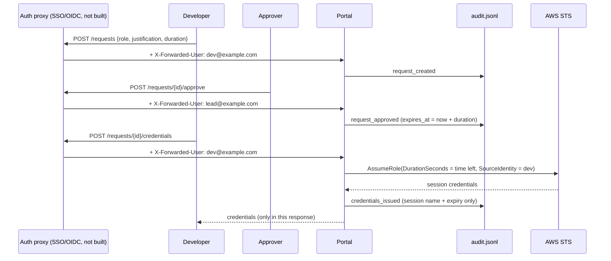

# Temporary IAM role access portal (FastAPI)

A small FastAPI backend where developers request temporary access to an
allowlisted AWS IAM role, an approver approves or denies it, and the
requester then fetches short-lived STS credentials that expire by
themselves. Every decision goes to an append-only JSON-lines audit log.

> **Status:** AWS IAM roles only. **Kubernetes namespace access is not
> implemented.** **Authentication is not built**: the caller's identity is
> read from an `X-Forwarded-User` header that a trusted proxy is expected to
> set. 24 pytest tests drive the API through FastAPI's `TestClient`, with an
> in-memory fake granter and an injected clock. The STS granter is tested
> against a fake STS client only. `portal/main.py` (the real entry point)
> is not exercised by tests, and nothing has called AWS.

## Problem

> Implement a self-service portal backend (FastAPI / Express) that allows
> developers to request temporary elevated IAM roles or Kubernetes namespace
> access with automatic expiration and audit logging.

## Flow



## Endpoints

| Method and path | Who | What |
|---|---|---|
| `POST /requests` | anyone | create a pending request |
| `GET /requests` | anyone | approvers see all, others see their own; approved requests past expiry show `expired` |
| `POST /requests/{id}/approve` | approvers | approve a pending request; starts the access window |
| `POST /requests/{id}/deny` | approvers | deny a pending request |
| `POST /requests/{id}/credentials` | the requester | issue an STS session for the time left in the window |

There is no endpoint that reads, edits or deletes the audit log, and no
`PUT`, `PATCH` or `DELETE` route at all. A test checks both.

## Rules

- **Role allowlist:** only roles in `Settings.roles` can be requested.
- **Justification required:** at least 10 non-blank characters.
- **Duration capped:** 900 to 3600 seconds. 900 is the STS minimum; 3600 is
  the cap here and also the STS limit when the portal itself runs as a role
  session (role chaining).
- **Four eyes:** only listed approvers can decide, and an approver can't
  approve or deny their own request. Refusals are written to the audit log.
- **One decision:** only `pending` requests can be approved or denied (409
  otherwise).
- **Expiry:** approval sets `expires_at = approved_at + duration`. Credentials
  are issued with `DurationSeconds` equal to the time left, so the STS
  session ends with the window; AWS enforces it, not this service. If less
  than 15 minutes remain, the request is refused because STS can't issue a
  shorter session. All time checks use an injected clock.
- **SourceIdentity:** the requester's identity is set as the STS source
  identity, so it appears in CloudTrail for every call made with the
  session. The role's trust policy must allow `sts:SetSourceIdentity`.

## Audit log

`audit.jsonl`, one JSON object per line, opened in append mode and
`fsync`ed per write. Events: `request_created`, `request_approved`,
`request_denied`, `decision_refused`, `credentials_issued`. Only a fixed
set of fields can be written. A test confirms that passing a credential
field raises an error, and that the issued secret, token and key ID never
appear in the file.

Append mode is not tamper-proof: anyone with write access to the file can
change it. For a real audit trail, ship it to write-once storage (for
example S3 Object Lock or a SIEM).

## Usage

```bash
python -m pip install -r requirements-dev.txt
python -m ruff check .
python -m ruff format --check .
python -m pytest -q

# Local run against real AWS (not tested here)
python -m pip install uvicorn
uvicorn portal.main:app --port 8000
curl -X POST localhost:8000/requests -H 'X-Forwarded-User: dev@example.com' \
  -H 'content-type: application/json' \
  -d '{"role": "prod-readonly", "justification": "INC-1234 investigate errors", "duration_seconds": 1800}'
```

Roles, approvers, limits and the audit log path are in `portal/settings.py`
(placeholder account `123456789012`).

## Limits

- No authentication. **A real deployment needs SSO with OIDC at a proxy**
  (for example an ALB with OIDC, or oauth2-proxy) that sets
  `X-Forwarded-User`, and the service must accept traffic only from that
  proxy. As built, anyone who can reach the service can claim any identity.
- Kubernetes namespace access is not implemented.
- Requests live in memory and are lost on restart. A database is not built.
- Approvers are a static list; no groups, no notifications.
- Credentials can be fetched more than once within the window; each fetch is
  audited.
- No rate limiting.

## Security notes

- Credentials are returned only to the requester, only in the HTTP response,
  and never logged.
- The portal's own IAM role needs `sts:AssumeRole` (and
  `sts:SetSourceIdentity`) on the allowlisted roles only.
- Session expiry is native to STS, so a crashed portal can't leave access
  open longer than approved.
